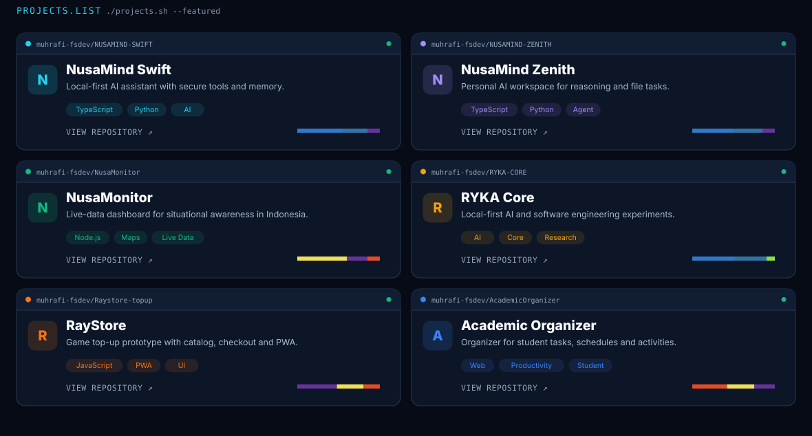

<picture>
  <source media="(prefers-color-scheme: dark)" srcset="https://raw.githubusercontent.com/muhrafi-fsdev/muhrafi-fsdev/main/assets/hero/command-center-dark-v2.svg">
  <source media="(prefers-color-scheme: light)" srcset="https://raw.githubusercontent.com/muhrafi-fsdev/muhrafi-fsdev/main/assets/hero/command-center-light-v2.svg">
  
</picture>

 

<picture>
  <source media="(prefers-color-scheme: dark)" srcset="https://raw.githubusercontent.com/muhrafi-fsdev/muhrafi-fsdev/main/assets/mission/rocket-v1-dark.svg">
  <source media="(prefers-color-scheme: light)" srcset="https://raw.githubusercontent.com/muhrafi-fsdev/muhrafi-fsdev/main/assets/mission/rocket-v1-light.svg">
  
</picture>

 

<picture>
  <source media="(prefers-color-scheme: dark)" srcset="https://raw.githubusercontent.com/muhrafi-fsdev/muhrafi-fsdev/main/projects.svg">
  <source media="(prefers-color-scheme: light)" srcset="https://raw.githubusercontent.com/muhrafi-fsdev/muhrafi-fsdev/main/projects-light.svg">
  
</picture>

 

Explore the featured repositories

  <a href="https://github.com/muhrafi-fsdev/NUSAMIND-SWIFT">NusaMind Swift</a> ·
  <a href="https://github.com/muhrafi-fsdev/NUSAMIND-ZENITH">NusaMind Zenith</a> ·
  <a href="https://github.com/muhrafi-fsdev/NusaMonitor">NusaMonitor</a> ·
  <a href="https://github.com/muhrafi-fsdev/RYKA-CORE">RYKA Core</a> ·
  <a href="https://github.com/muhrafi-fsdev/Raystore-topup">RayStore</a> ·
  <a href="https://github.com/muhrafi-fsdev/AcademicOrganizer">Academic Organizer</a>

&nbsp;

&nbsp;

&nbsp;

