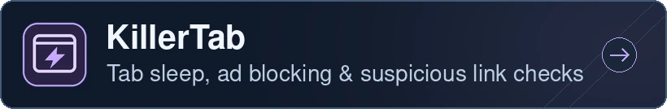
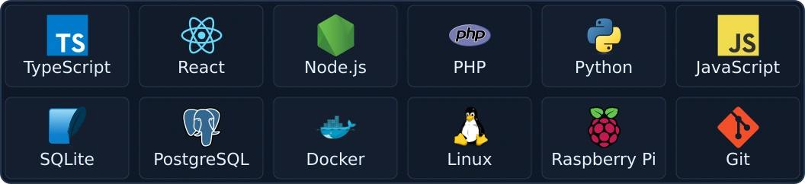

<h1 align="center">
  <picture>
    <source media="(prefers-reduced-motion: no-preference)" type="image/webp" srcset="assets/city-window/header.webp">
    
  </picture>
</h1>

  <a href="https://riyooprivateweb.my.id/PORTFOLIO_WEB/">Portfolio</a> ·
  <a href="https://www.linkedin.com/in/rafipriyo">LinkedIn</a> ·
  <a href="https://www.instagram.com/mhmmd_rayfy">Instagram</a> ·
  <a href="mailto:raymufiyo@gmail.com">Email</a>

## Latest projects

  

  

## About me

> I study **Telecommunication Engineering** at **Telkom University** and build projects for the web, local devices, and sensor networks.

**Web development.** I build browser tools and dashboards, including [NusaMonitor](https://github.com/muhrafi-fsdev/NusaMonitor), an interactive map of live public data across Indonesia.

**Local AI.** I build tools that run on the user’s machine. [NusaMind Zenith](https://github.com/muhrafi-fsdev/NUSAMIND-ZENITH) is my workspace for working across files and keeping project context.

**IoT and networking.** I use Raspberry Pi and MQTT to collect sensor readings and test how telemetry moves between devices.

## Selected projects

- [NusaMind Zenith](https://github.com/muhrafi-fsdev/NUSAMIND-ZENITH) · Local-first AI workspace for multi-file projects
- [NusaMonitor](https://github.com/muhrafi-fsdev/NusaMonitor) · Interactive map of live public data for Indonesia
- [RYKA Core](https://github.com/muhrafi-fsdev/RYKA-CORE) · Gesture controls for accessible desktop interaction

## Toolkit

  <picture>
    <source media="(max-width: 600px) and (prefers-color-scheme: light)" srcset="assets/nightshift/refined/toolkit-light-compact.webp">
    <source media="(max-width: 600px)" srcset="assets/nightshift/refined/toolkit-dark-compact.webp">
    <source media="(prefers-color-scheme: light)" srcset="assets/nightshift/refined/toolkit-light.webp">
    <source media="(prefers-color-scheme: dark)" srcset="assets/nightshift/refined/toolkit-dark.webp">
    
  </picture>

## Public repository activity

<!-- LIVE_REPOS_START -->
**Latest push** · [KillerTab](https://github.com/muhrafi-fsdev/KillerTab) · 21 Nov 2026 (UTC)

| Repository | Last push (UTC) |
| :-- | --: |
| **[KillerTab](https://github.com/muhrafi-fsdev/KillerTab)** Tab sleep, ad blocking, and suspicious link checks · JavaScript | 21&nbsp;Nov&nbsp;2026 |
| **[YouTube Ambient Glass](https://github.com/muhrafi-fsdev/YouTube-Ambient)** Video-powered ambience for YouTube · JavaScript | 21&nbsp;Nov&nbsp;2026 |
| **[RYKA Core](https://github.com/muhrafi-fsdev/RYKA-CORE)** Gesture controls for accessible desktop interaction · TypeScript | 25&nbsp;Oct&nbsp;2026 |
| **[NusaMind Zenith](https://github.com/muhrafi-fsdev/NUSAMIND-ZENITH)** Local-first AI workspace for multi-file projects · TypeScript | 23&nbsp;Oct&nbsp;2026 |
| **[NusaMind Swift](https://github.com/muhrafi-fsdev/NUSAMIND-SWIFT)** Local AI assistant with retrieval and memory · TypeScript | 15&nbsp;Sep&nbsp;2026 |
| **[NusaMonitor](https://github.com/muhrafi-fsdev/NusaMonitor)** Live public data mapping dashboard for Indonesia · JavaScript | 25&nbsp;Jul&nbsp;2026 |
| **[RayStore](https://github.com/muhrafi-fsdev/Raystore-topup)** Game top-up storefront prototype · CSS | 24&nbsp;Jul&nbsp;2026 |
| **[Academic Organizer](https://github.com/muhrafi-fsdev/AcademicOrganizer)** Student tasks, schedules, and academic planning · HTML | 11&nbsp;Feb&nbsp;2026 |
<!-- LIVE_REPOS_END -->

[Browse all repositories](https://github.com/muhrafi-fsdev?tab=repositories) · Push dates updated by GitHub Actions.

## GitHub activity

  <picture>
    <source media="(prefers-color-scheme: light)" srcset="assets/nightshift/activity-light.svg">
    <source media="(prefers-color-scheme: dark)" srcset="assets/nightshift/activity-dark.svg">
    
  </picture>

12-week snapshot from my public GitHub calendar. The contribution snake below updates separately.

<picture>
  <source media="(prefers-color-scheme: dark)" srcset="https://raw.githubusercontent.com/muhrafi-fsdev/muhrafi-fsdev/output/snake-dark.svg?v=restore-command-center-20261110">
  <source media="(prefers-color-scheme: light)" srcset="https://raw.githubusercontent.com/muhrafi-fsdev/muhrafi-fsdev/output/snake-light.svg?v=restore-command-center-20261110">
  
</picture>

Archive · Pixel rocket and Signal Lab animations

<picture>
  <source media="(prefers-color-scheme: dark)" type="image/webp" srcset="https://raw.githubusercontent.com/muhrafi-fsdev/muhrafi-fsdev/motion/rocket-launch-dark.webp?v=frame-motion-25fps-20261110">
  <source media="(prefers-color-scheme: light)" type="image/webp" srcset="https://raw.githubusercontent.com/muhrafi-fsdev/muhrafi-fsdev/motion/rocket-launch-light.webp?v=frame-motion-25fps-20261110">
  <source media="(prefers-color-scheme: dark)" type="image/gif" srcset="https://raw.githubusercontent.com/muhrafi-fsdev/muhrafi-fsdev/motion/rocket-launch-dark.gif?v=frame-motion-25fps-20261110">
  <source media="(prefers-color-scheme: light)" type="image/gif" srcset="https://raw.githubusercontent.com/muhrafi-fsdev/muhrafi-fsdev/motion/rocket-launch-light.gif?v=frame-motion-25fps-20261110">
  
</picture>

<picture>
  <source media="(prefers-reduced-motion: reduce) and (prefers-color-scheme: light)" type="image/webp" srcset="assets/signal-lab/signal-light-still.webp">
  <source media="(prefers-reduced-motion: reduce)" type="image/webp" srcset="assets/signal-lab/signal-dark-still.webp">
  <source media="(prefers-color-scheme: light)" type="image/webp" srcset="assets/signal-lab/signal-light.webp">
  <source media="(prefers-color-scheme: dark)" type="image/webp" srcset="assets/signal-lab/signal-dark.webp">
  
</picture>

