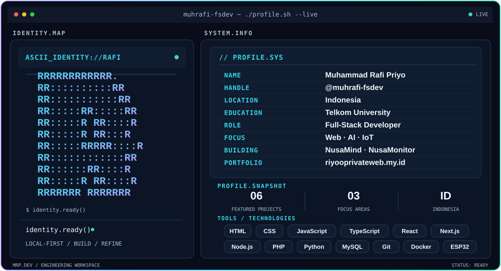
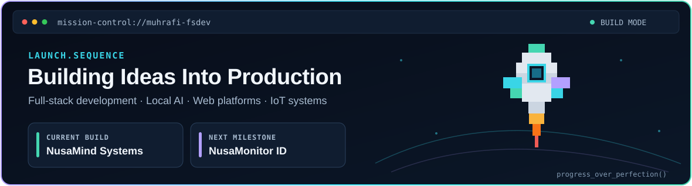

<!-- PROFILE README: hybrid design. Native GitHub Markdown + animated SVG assets. -->

  <h2>MUHAMMAD RAFI PRIYO</h2>
  
<strong>Full-Stack Developer</strong> · Telecommunications Engineering · Telkom University

  
Web platforms, edge &amp; IoT, local-first AI, and practical software engineering.

<picture>
  <source media="(prefers-color-scheme: dark)" srcset="https://raw.githubusercontent.com/muhrafi-fsdev/muhrafi-fsdev/main/assets/hero/command-center-dark-v2.svg?v=20261110-hybrid4">
  <source media="(prefers-color-scheme: light)" srcset="https://raw.githubusercontent.com/muhrafi-fsdev/muhrafi-fsdev/main/assets/hero/command-center-light-v2.svg?v=20261110-hybrid4">
  
</picture>

  
  
  
  

---

### `01 / About & current work`

I build software from user interfaces to backend services, with a growing focus on **intelligent systems and connectivity**. My work blends full-stack development with experimentation around Raspberry Pi, MQTT, automation, and local-first AI.

| Currently exploring | Engineering approach |
| :-- | :-- |
| Web platforms and UI/UX | Clear interfaces, maintainable architecture |
| Edge computing and IoT | Measurable data pipelines and reliability |
| Local AI and developer tools | Privacy, reproducibility, and secure design |

### `02 / Launch sequence`

<picture>
  <source media="(prefers-color-scheme: dark)" srcset="https://raw.githubusercontent.com/muhrafi-fsdev/muhrafi-fsdev/main/assets/mission/rocket-v1-dark.svg?v=20261110-hybrid4">
  <source media="(prefers-color-scheme: light)" srcset="https://raw.githubusercontent.com/muhrafi-fsdev/muhrafi-fsdev/main/assets/mission/rocket-v1-light.svg?v=20261110-hybrid4">
  
</picture>

The current work spans **NusaMind** tools and the **NusaMonitor** ecosystem. Projects evolve through prototyping, testing, and iteration, not imaginary progress percentages.

### `03 / Featured repositories`

These are **real GitHub links with selectable text**, not screenshots or image-only project cards.

<table width="100%">
<tr>
<td width="50%" valign="top">
  <strong><a href="https://github.com/muhrafi-fsdev/NUSAMIND-SWIFT">NusaMind Swift</a></strong> 
  Local-first AI assistant with bounded reasoning, retrieval, and privacy-aware workflows. 
  TypeScript · Python · AI
</td>
<td width="50%" valign="top">
  <strong><a href="https://github.com/muhrafi-fsdev/NUSAMIND-ZENITH">NusaMind Zenith</a></strong> 
  Personal AI workspace for multi-file tasks, reasoning, and automation. 
  TypeScript · Python · Agent
</td>
</tr>
<tr>
<td width="50%" valign="top">
  <strong><a href="https://github.com/muhrafi-fsdev/NusaMonitor">NusaMonitor</a></strong> 
  Monitoring dashboard focused on Indonesian public live-data sources. 
  JavaScript · Maps · Monitoring
</td>
<td width="50%" valign="top">
  <strong><a href="https://github.com/muhrafi-fsdev/RYKA-CORE">RYKA Core</a></strong> 
  Accessible gesture control and secure desktop interaction experiments. 
  TypeScript · Desktop · AI
</td>
</tr>
<tr>
<td width="50%" valign="top">
  <strong><a href="https://github.com/muhrafi-fsdev/Raystore-topup">RayStore</a></strong> 
  Digital top-up prototype with product catalog and checkout features. 
  Web · CSS · JavaScript
</td>
<td width="50%" valign="top">
  <strong><a href="https://github.com/muhrafi-fsdev/AcademicOrganizer">Academic Organizer</a></strong> 
  A practical workspace for student tasks, schedules, and academic activities. 
  HTML · JavaScript · Productivity
</td>
</tr>
</table>

<strong>Open live repository data</strong> · language, last push, stars

Generated from the official GitHub API. The scheduled workflow updates this Markdown table without inventing statistics.

<!-- LIVE_REPOS_START -->
| Repository | Primary language | Last push (UTC) | Stars |
| :-- | :-- | :-- | --: |
| [NusaMind Swift](https://github.com/muhrafi-fsdev/NUSAMIND-SWIFT) | TypeScript | 2026-09-15 | 0 |
| [NusaMind Zenith](https://github.com/muhrafi-fsdev/NUSAMIND-ZENITH) | TypeScript | 2026-10-23 | 0 |
| [NusaMonitor](https://github.com/muhrafi-fsdev/NusaMonitor) | JavaScript | 2026-07-25 | 0 |
| [RYKA Core](https://github.com/muhrafi-fsdev/RYKA-CORE) | TypeScript | 2026-10-25 | 0 |
| [RayStore](https://github.com/muhrafi-fsdev/Raystore-topup) | CSS | 2026-07-24 | 0 |
| [Academic Organizer](https://github.com/muhrafi-fsdev/AcademicOrganizer) | HTML | 2026-02-11 | 0 |
<!-- LIVE_REPOS_END -->

### `04 / Engineering toolkit`

**Languages & web:** `TypeScript` · `JavaScript` · `Python` · `PHP` · `HTML` · `CSS`

**Platforms & infrastructure:** `React` · `Node.js` · `Docker` · `Linux` · `Git`

**Networks & intelligent systems:** `MQTT` · `Raspberry Pi` · `ESP32` · `Local AI`

### `05 / Contribution flight`

<picture>
  <source media="(prefers-color-scheme: dark)" srcset="https://raw.githubusercontent.com/muhrafi-fsdev/muhrafi-fsdev/output/snake-dark.svg?v=20261110-hybrid4">
  <source media="(prefers-color-scheme: light)" srcset="https://raw.githubusercontent.com/muhrafi-fsdev/muhrafi-fsdev/output/snake-light.svg?v=20261110-hybrid4">
  
</picture>

Contribution animation is generated by <a href="https://github.com/muhrafi-fsdev/muhrafi-fsdev/actions/workflows/snake.yml">GitHub Actions</a> from public contributions. The regular GitHub contribution calendar remains below the README.

<strong>Command center notes</strong>

- Native GitHub Markdown and HTML carry the actual profile information and clickable project links.
- The command center, pixel rocket, and contribution snake provide motion without JavaScript.
- GitHub Actions refreshes the repository activity table on a schedule. See <a href="https://github.com/muhrafi-fsdev/muhrafi-fsdev/actions/workflows/profile-live.yml">workflow status</a>.
- Full browser-like interactivity is available through the <a href="https://riyooprivateweb.my.id/PORTFOLIO_WEB/">web portfolio</a>; GitHub READMEs intentionally restrict scripts.

  BUILD · TEST · REFINE

