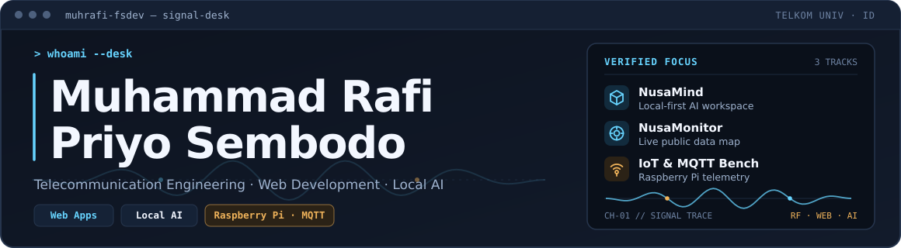
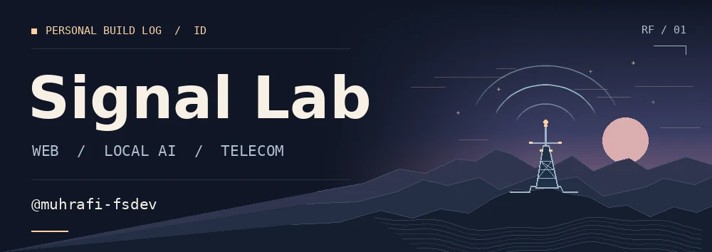

<h1 align="center">
  <picture>
    <source media="(max-width: 600px) and (prefers-color-scheme: light)" srcset="assets/nightshift/signal-desk/hero-light-compact.svg">
    <source media="(max-width: 600px)" srcset="assets/nightshift/signal-desk/hero-dark-compact.svg">
    <source media="(prefers-color-scheme: light)" srcset="assets/nightshift/signal-desk/hero-light.svg">
    <source media="(prefers-color-scheme: dark)" srcset="assets/nightshift/signal-desk/hero-dark.svg">
    
  </picture>
</h1>

  <picture>
    <source media="(prefers-reduced-motion: reduce) and (prefers-color-scheme: light)" srcset="assets/nightshift/signal-desk/signal-pulse-light-still.webp">
    <source media="(prefers-reduced-motion: reduce)" srcset="assets/nightshift/signal-desk/signal-pulse-dark-still.webp">
    <source media="(prefers-color-scheme: light)" srcset="assets/nightshift/signal-desk/signal-pulse-light.webp">
    <source media="(prefers-color-scheme: dark)" srcset="assets/nightshift/signal-desk/signal-pulse-dark.webp">
    
  </picture>

  <a href="https://riyooprivateweb.my.id/PORTFOLIO_WEB/"><picture>
    <source media="(prefers-color-scheme: light)" srcset="assets/nightshift/signal-desk/btn-portfolio-light.svg">
    <source media="(prefers-color-scheme: dark)" srcset="assets/nightshift/signal-desk/btn-portfolio-dark.svg">
    
  </picture></a>&nbsp;
  <a href="https://www.linkedin.com/in/rafipriyo"><picture>
    <source media="(prefers-color-scheme: light)" srcset="assets/nightshift/signal-desk/btn-linkedin-light.svg">
    <source media="(prefers-color-scheme: dark)" srcset="assets/nightshift/signal-desk/btn-linkedin-dark.svg">
    
  </picture></a>&nbsp;
  <a href="https://www.instagram.com/mhmmd_rayfy"><picture>
    <source media="(prefers-color-scheme: light)" srcset="assets/nightshift/signal-desk/btn-instagram-light.svg">
    <source media="(prefers-color-scheme: dark)" srcset="assets/nightshift/signal-desk/btn-instagram-dark.svg">
    
  </picture></a>&nbsp;
  <a href="mailto:raymufiyo@gmail.com"><picture>
    <source media="(prefers-color-scheme: light)" srcset="assets/nightshift/signal-desk/btn-email-light.svg">
    <source media="(prefers-color-scheme: dark)" srcset="assets/nightshift/signal-desk/btn-email-dark.svg">
    
  </picture></a>

## About me · Field Notes

I am a **Telecommunication Engineering** student at **Telkom University**, building web applications, local-first AI tools, and connected hardware experiments.

- **Web Development** — Full-stack web interfaces and live public data dashboards · e.g. [NusaMonitor](https://github.com/muhrafi-fsdev/NusaMonitor)
- **Local AI** — Privacy-aware retrieval, bounded reasoning, and local-first assistants · e.g. [NusaMind Zenith](https://github.com/muhrafi-fsdev/NUSAMIND-ZENITH)
- **IoT & Networking** — Embedded telemetry, sensor nodes, and brokered messaging · e.g. Raspberry Pi & MQTT bench experiments

## Selected projects

Curated highlights across architecture, UI, and local-first tooling:

- **[NusaMind Zenith](https://github.com/muhrafi-fsdev/NUSAMIND-ZENITH)** — Local-first AI workspace structured for multi-file projects and context continuity.
- **[NusaMonitor](https://github.com/muhrafi-fsdev/NusaMonitor)** — Interactive dashboard mapping live public data across Indonesia.
- **[RYKA Core](https://github.com/muhrafi-fsdev/RYKA-CORE)** — Accessible gesture control and desktop interaction platform.

## Public repository activity

<!-- LIVE_REPOS_START -->
<strong>Latest public push</strong> · <a href="https://github.com/muhrafi-fsdev/RYKA-CORE">RYKA Core</a> · 25 Oct 2026 (UTC)

| Repository | Function | Language | Last push (UTC) |
| :-- | :-- | :-- | --: |
| [RYKA Core](https://github.com/muhrafi-fsdev/RYKA-CORE) | Accessible gesture control and secure desktop interaction platform. | TypeScript | 2026-10-25 |
| [NusaMind Zenith](https://github.com/muhrafi-fsdev/NUSAMIND-ZENITH) | Local-first AI workspace for multi-file projects | TypeScript | 2026-10-23 |
| [NusaMind Swift](https://github.com/muhrafi-fsdev/NUSAMIND-SWIFT) | Fast local-first AI assistant with bounded reasoning, verified retrieval, privacy-aware memory, and defensive cybersecurity. | TypeScript | 2026-09-15 |
| [NusaMonitor](https://github.com/muhrafi-fsdev/NusaMonitor) | Live public data mapping dashboard for Indonesia | JavaScript | 2026-07-25 |
| [RayStore](https://github.com/muhrafi-fsdev/Raystore-topup) | LANDING TOP UP | CSS | 2026-07-24 |
| [Academic Organizer](https://github.com/muhrafi-fsdev/AcademicOrganizer) | Student tasks, schedules, and academic planning | HTML | 2026-02-11 |
<!-- LIVE_REPOS_END -->

Activity data refreshed from public GitHub metadata by GitHub Actions.

## GitHub activity

  <picture>
    <source media="(prefers-color-scheme: light)" srcset="assets/nightshift/activity-light.svg">
    <source media="(prefers-color-scheme: dark)" srcset="assets/nightshift/activity-dark.svg">
    
  </picture>

12-week snapshot from my public GitHub calendar. The contribution snake below updates separately.

<picture>
  <source media="(prefers-color-scheme: dark)" srcset="https://raw.githubusercontent.com/muhrafi-fsdev/muhrafi-fsdev/output/snake-dark.svg?v=restore-command-center-20261110">
  <source media="(prefers-color-scheme: light)" srcset="https://raw.githubusercontent.com/muhrafi-fsdev/muhrafi-fsdev/output/snake-light.svg?v=restore-command-center-20261110">
  
</picture>

<h2 align="center">Toolkit</h2>

  <picture>
    <source media="(max-width: 600px) and (prefers-color-scheme: light)" srcset="assets/nightshift/refined/toolkit-light-compact.webp">
    <source media="(max-width: 600px)" srcset="assets/nightshift/refined/toolkit-dark-compact.webp">
    <source media="(prefers-color-scheme: light)" srcset="assets/nightshift/refined/toolkit-light.webp">
    <source media="(prefers-color-scheme: dark)" srcset="assets/nightshift/refined/toolkit-dark.webp">
    
  </picture>

Archive · Pixel rocket and Signal Lab animations

<picture>
  <source media="(prefers-color-scheme: dark)" type="image/webp" srcset="https://raw.githubusercontent.com/muhrafi-fsdev/muhrafi-fsdev/motion/rocket-launch-dark.webp?v=frame-motion-25fps-20261110">
  <source media="(prefers-color-scheme: light)" type="image/webp" srcset="https://raw.githubusercontent.com/muhrafi-fsdev/muhrafi-fsdev/motion/rocket-launch-light.webp?v=frame-motion-25fps-20261110">
  <source media="(prefers-color-scheme: dark)" type="image/gif" srcset="https://raw.githubusercontent.com/muhrafi-fsdev/muhrafi-fsdev/motion/rocket-launch-dark.gif?v=frame-motion-25fps-20261110">
  <source media="(prefers-color-scheme: light)" type="image/gif" srcset="https://raw.githubusercontent.com/muhrafi-fsdev/muhrafi-fsdev/motion/rocket-launch-light.gif?v=frame-motion-25fps-20261110">
  
</picture>

<picture>
  <source media="(prefers-reduced-motion: reduce) and (prefers-color-scheme: light)" type="image/webp" srcset="assets/signal-lab/signal-light-still.webp">
  <source media="(prefers-reduced-motion: reduce)" type="image/webp" srcset="assets/signal-lab/signal-dark-still.webp">
  <source media="(prefers-color-scheme: light)" type="image/webp" srcset="assets/signal-lab/signal-light.webp">
  <source media="(prefers-color-scheme: dark)" type="image/webp" srcset="assets/signal-lab/signal-dark.webp">
  
</picture>

