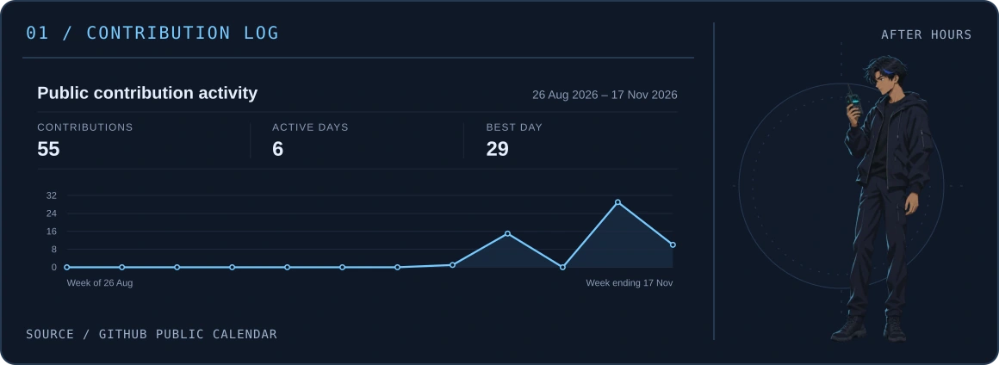

<picture>
  <source media="(prefers-reduced-motion: no-preference)" type="image/webp" srcset="assets/nightshift/refined/banner-motion.webp">
  
</picture>

<h1 align="center">Hi, I’m Rafi</h1>

  Telecommunication Engineering · Web development · Local AI

  &nbsp;
  &nbsp;
  &nbsp;
  

## About me

<table>
  <tr><th scope="row">Studying</th><td>Telecommunication Engineering at Telkom University</td></tr>
  <tr><th scope="row">Building</th><td>NusaMind and other local-first AI tools</td></tr>
  <tr><th scope="row">On the bench</th><td>Raspberry Pi and MQTT experiments</td></tr>
</table>

 

## GitHub activity

<picture>
  <source media="(max-width: 600px) and (prefers-color-scheme: light)" srcset="assets/nightshift/activity-light.svg">
  <source media="(max-width: 600px)" srcset="assets/nightshift/activity-dark.svg">
  <source media="(prefers-color-scheme: light)" srcset="assets/nightshift/refined/activity-light-wide.webp">
  <source media="(prefers-color-scheme: dark)" srcset="assets/nightshift/refined/activity-dark-wide.webp">
  
</picture>

12-week snapshot from my public GitHub calendar. The contribution snake below updates separately.

<picture>
  <source media="(prefers-color-scheme: dark)" srcset="https://raw.githubusercontent.com/muhrafi-fsdev/muhrafi-fsdev/output/snake-dark.svg?v=restore-command-center-20261110">
  <source media="(prefers-color-scheme: light)" srcset="https://raw.githubusercontent.com/muhrafi-fsdev/muhrafi-fsdev/output/snake-light.svg?v=restore-command-center-20261110">
  
</picture>

Public repository activity

<!-- LIVE_REPOS_START -->
| Repository | Primary language | Last push (UTC) | Stars |
| :-- | :-- | :-- | --: |
| [NusaMind Swift](https://github.com/muhrafi-fsdev/NUSAMIND-SWIFT) | TypeScript | 2026-09-15 | 0 |
| [NusaMind Zenith](https://github.com/muhrafi-fsdev/NUSAMIND-ZENITH) | TypeScript | 2026-10-23 | 0 |
| [NusaMonitor](https://github.com/muhrafi-fsdev/NusaMonitor) | JavaScript | 2026-07-25 | 0 |
| [RYKA Core](https://github.com/muhrafi-fsdev/RYKA-CORE) | TypeScript | 2026-10-25 | 0 |
| [RayStore](https://github.com/muhrafi-fsdev/Raystore-topup) | CSS | 2026-07-24 | 0 |
| [Academic Organizer](https://github.com/muhrafi-fsdev/AcademicOrganizer) | HTML | 2026-02-11 | 0 |
<!-- LIVE_REPOS_END -->

Refreshed by GitHub Actions using public GitHub repository data.

<h2 align="center">Toolkit</h2>

<picture>
  <source media="(max-width: 600px) and (prefers-color-scheme: light)" srcset="assets/nightshift/refined/toolkit-light-compact.webp">
  <source media="(max-width: 600px)" srcset="assets/nightshift/refined/toolkit-dark-compact.webp">
  <source media="(prefers-color-scheme: light)" srcset="assets/nightshift/refined/toolkit-light.webp">
  <source media="(prefers-color-scheme: dark)" srcset="assets/nightshift/refined/toolkit-dark.webp">
  
</picture>

## Selected projects

| Project | What it does |
| :-- | :-- |
| [NusaMind Zenith](https://github.com/muhrafi-fsdev/NUSAMIND-ZENITH) | Local-first AI workspace for projects that span multiple files |
| [NusaMonitor](https://github.com/muhrafi-fsdev/NusaMonitor) | A dashboard that maps public live data for Indonesia |
| [NusaMind Swift](https://github.com/muhrafi-fsdev/NUSAMIND-SWIFT) | Lightweight local AI assistant for file analysis, retrieval, and memory |

Also on GitHub: [RYKA Core](https://github.com/muhrafi-fsdev/RYKA-CORE) · [RayStore](https://github.com/muhrafi-fsdev/Raystore-topup) · [Academic Organizer](https://github.com/muhrafi-fsdev/AcademicOrganizer)

Archive · Pixel rocket and Signal Lab animations

<picture>
  <source media="(prefers-color-scheme: dark)" type="image/webp" srcset="https://raw.githubusercontent.com/muhrafi-fsdev/muhrafi-fsdev/motion/rocket-launch-dark.webp?v=frame-motion-25fps-20261110">
  <source media="(prefers-color-scheme: light)" type="image/webp" srcset="https://raw.githubusercontent.com/muhrafi-fsdev/muhrafi-fsdev/motion/rocket-launch-light.webp?v=frame-motion-25fps-20261110">
  <source media="(prefers-color-scheme: dark)" type="image/gif" srcset="https://raw.githubusercontent.com/muhrafi-fsdev/muhrafi-fsdev/motion/rocket-launch-dark.gif?v=frame-motion-25fps-20261110">
  <source media="(prefers-color-scheme: light)" type="image/gif" srcset="https://raw.githubusercontent.com/muhrafi-fsdev/muhrafi-fsdev/motion/rocket-launch-light.gif?v=frame-motion-25fps-20261110">
  
</picture>

<picture>
  <source media="(prefers-reduced-motion: reduce) and (prefers-color-scheme: light)" type="image/webp" srcset="assets/signal-lab/signal-light-still.webp">
  <source media="(prefers-reduced-motion: reduce)" type="image/webp" srcset="assets/signal-lab/signal-dark-still.webp">
  <source media="(prefers-color-scheme: light)" type="image/webp" srcset="assets/signal-lab/signal-light.webp">
  <source media="(prefers-color-scheme: dark)" type="image/webp" srcset="assets/signal-lab/signal-dark.webp">
  
</picture>

