<h1 align="center">
  <picture>
    <source media="(prefers-reduced-motion: no-preference)" type="image/webp" srcset="assets/city-window/header.webp">
    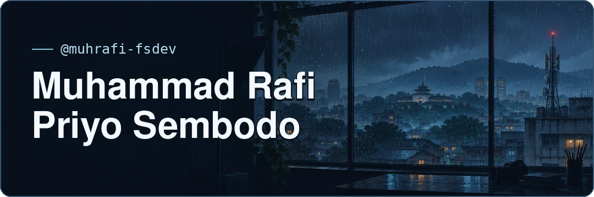
  </picture>
</h1>

  <a href="https://riyooprivateweb.my.id/PORTFOLIO_WEB/">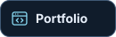</a>
  
  <a href="https://www.instagram.com/mhmmd_rayfy">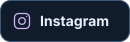</a>
  

## Latest projects

  <a href="https://github.com/muhrafi-fsdev/YouTube-Ambient">
    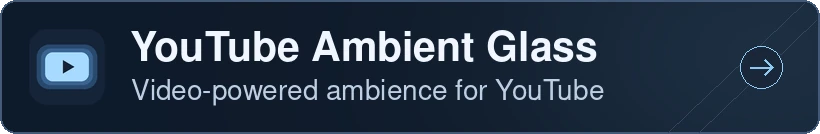
  </a>

  

## About me

I’m a **Telecommunication Engineering** student at **Telkom University**. I build browser tools, local AI workspaces, and connected devices.

<picture>
  <source media="(max-width: 600px)" srcset="assets/city-window/profile/focus-compact.svg">
  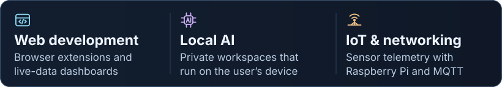
</picture>

## Selected projects

  <a href="https://github.com/muhrafi-fsdev/NUSAMIND-ZENITH"><picture>
    <source media="(max-width: 600px)" srcset="assets/city-window/profile/zenith-compact.svg">
    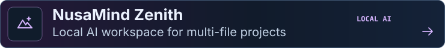
  </picture></a> 
  <a href="https://github.com/muhrafi-fsdev/NusaMonitor"><picture>
    <source media="(max-width: 600px)" srcset="assets/city-window/profile/map-compact.svg">
    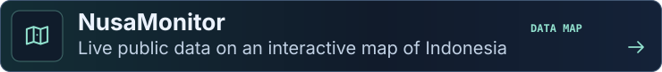
  </picture></a> 
  <a href="https://github.com/muhrafi-fsdev/RYKA-CORE"><picture>
    <source media="(max-width: 600px)" srcset="assets/city-window/profile/gesture-compact.svg">
    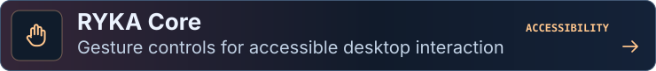
  </picture></a>

## Toolkit

  <picture>
    <source media="(max-width: 600px) and (prefers-color-scheme: light)" srcset="assets/nightshift/refined/toolkit-light-compact.webp">
    <source media="(max-width: 600px)" srcset="assets/nightshift/refined/toolkit-dark-compact.webp">
    <source media="(prefers-color-scheme: light)" srcset="assets/nightshift/refined/toolkit-light.webp">
    <source media="(prefers-color-scheme: dark)" srcset="assets/nightshift/refined/toolkit-dark.webp">
    
  </picture>

## Public repository activity

<!-- LIVE_REPOS_START -->
**Latest push** · [KillerTab](https://github.com/muhrafi-fsdev/KillerTab) · 26 Nov 2026 (UTC)

  <a href="https://github.com/muhrafi-fsdev/KillerTab"><picture>
    <source media="(max-width: 600px)" srcset="assets/city-window/activity/killertab-compact.svg">
    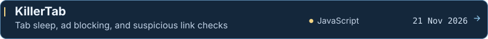
  </picture></a> 
  <a href="https://github.com/muhrafi-fsdev/YouTube-Ambient"><picture>
    <source media="(max-width: 600px)" srcset="assets/city-window/activity/youtube-ambient-compact.svg">
    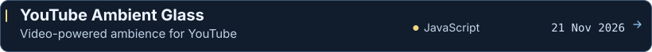
  </picture></a> 
  <a href="https://github.com/muhrafi-fsdev/RYKA-CORE"><picture>
    <source media="(max-width: 600px)" srcset="assets/city-window/activity/ryka-core-compact.svg">
    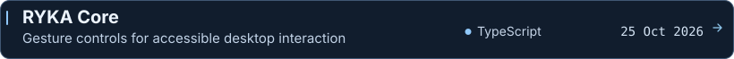
  </picture></a> 
  <a href="https://github.com/muhrafi-fsdev/NUSAMIND-ZENITH"><picture>
    <source media="(max-width: 600px)" srcset="assets/city-window/activity/nusamind-zenith-compact.svg">
    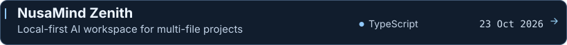
  </picture></a> 
  <a href="https://github.com/muhrafi-fsdev/NUSAMIND-SWIFT"><picture>
    <source media="(max-width: 600px)" srcset="assets/city-window/activity/nusamind-swift-compact.svg">
    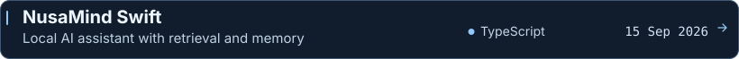
  </picture></a> 
  <a href="https://github.com/muhrafi-fsdev/NusaMonitor"><picture>
    <source media="(max-width: 600px)" srcset="assets/city-window/activity/nusamonitor-compact.svg">
    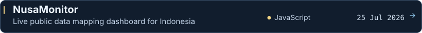
  </picture></a> 
  <a href="https://github.com/muhrafi-fsdev/Raystore-topup"><picture>
    <source media="(max-width: 600px)" srcset="assets/city-window/activity/raystore-topup-compact.svg">
    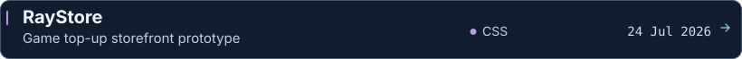
  </picture></a> 
  <a href="https://github.com/muhrafi-fsdev/AcademicOrganizer"><picture>
    <source media="(max-width: 600px)" srcset="assets/city-window/activity/academicorganizer-compact.svg">
    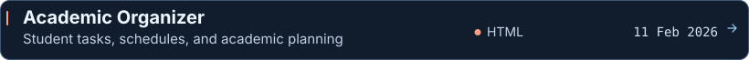
  </picture></a>

<!-- LIVE_REPOS_END -->

[Browse all repositories →](https://github.com/muhrafi-fsdev?tab=repositories)

## GitHub activity

  <picture>
    <source media="(prefers-color-scheme: light)" srcset="assets/nightshift/activity-light.svg">
    <source media="(prefers-color-scheme: dark)" srcset="assets/nightshift/activity-dark.svg">
    
  </picture>

12-week snapshot from my public GitHub calendar. The contribution snake below updates separately.

<picture>
  <source media="(prefers-color-scheme: dark)" srcset="https://raw.githubusercontent.com/muhrafi-fsdev/muhrafi-fsdev/output/snake-dark.svg?v=restore-command-center-20261110">
  <source media="(prefers-color-scheme: light)" srcset="https://raw.githubusercontent.com/muhrafi-fsdev/muhrafi-fsdev/output/snake-light.svg?v=restore-command-center-20261110">
  
</picture>

Archive · Pixel rocket and Signal Lab animations

<picture>
  <source media="(prefers-color-scheme: dark)" type="image/webp" srcset="https://raw.githubusercontent.com/muhrafi-fsdev/muhrafi-fsdev/motion/rocket-launch-dark.webp?v=frame-motion-25fps-20261110">
  <source media="(prefers-color-scheme: light)" type="image/webp" srcset="https://raw.githubusercontent.com/muhrafi-fsdev/muhrafi-fsdev/motion/rocket-launch-light.webp?v=frame-motion-25fps-20261110">
  <source media="(prefers-color-scheme: dark)" type="image/gif" srcset="https://raw.githubusercontent.com/muhrafi-fsdev/muhrafi-fsdev/motion/rocket-launch-dark.gif?v=frame-motion-25fps-20261110">
  <source media="(prefers-color-scheme: light)" type="image/gif" srcset="https://raw.githubusercontent.com/muhrafi-fsdev/muhrafi-fsdev/motion/rocket-launch-light.gif?v=frame-motion-25fps-20261110">
  
</picture>

<picture>
  <source media="(prefers-reduced-motion: reduce) and (prefers-color-scheme: light)" type="image/webp" srcset="assets/signal-lab/signal-light-still.webp">
  <source media="(prefers-reduced-motion: reduce)" type="image/webp" srcset="assets/signal-lab/signal-dark-still.webp">
  <source media="(prefers-color-scheme: light)" type="image/webp" srcset="assets/signal-lab/signal-light.webp">
  <source media="(prefers-color-scheme: dark)" type="image/webp" srcset="assets/signal-lab/signal-dark.webp">
  
</picture>

