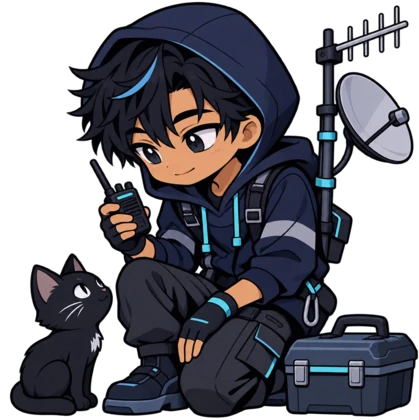
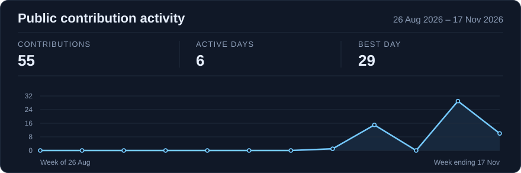
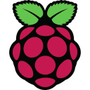
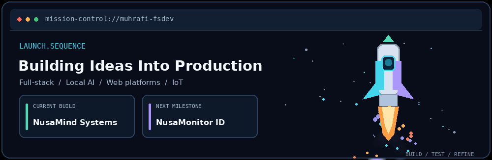

<h1 align="center">Hi, I’m Rafi</h1>

  <a href="https://riyooprivateweb.my.id/PORTFOLIO_WEB/">Portfolio</a> &nbsp;·&nbsp;
  <a href="https://www.linkedin.com/in/rafipriyo">LinkedIn</a> &nbsp;·&nbsp;
  <a href="https://www.instagram.com/mhmmd_rayfy">Instagram</a> &nbsp;·&nbsp;
  <a href="mailto:raymufiyo@gmail.com">Email</a>

## About me

<table>
  <tr>
    <td valign="middle">
      <strong>Studying</strong> 
      Telecommunication Engineering at Telkom University  
      <strong>Building</strong> 
      Web apps and local-first AI tools, including NusaMind  
      <strong>On the bench</strong> 
      IoT experiments with Raspberry Pi and MQTT
    </td>
    <td align="center" valign="middle">
      
    </td>
  </tr>
</table>

## GitHub activity

<picture>
  <source media="(prefers-color-scheme: light)" srcset="assets/nightshift/activity-light.svg">
  <source media="(prefers-color-scheme: dark)" srcset="assets/nightshift/activity-dark.svg">
  
</picture>

Dated snapshot of my public GitHub calendar. The contribution snake below updates separately.

<picture>
  <source media="(prefers-color-scheme: dark)" srcset="https://raw.githubusercontent.com/muhrafi-fsdev/muhrafi-fsdev/output/snake-dark.svg?v=restore-command-center-20261110">
  <source media="(prefers-color-scheme: light)" srcset="https://raw.githubusercontent.com/muhrafi-fsdev/muhrafi-fsdev/output/snake-light.svg?v=restore-command-center-20261110">
  
</picture>

Public repository activity

<!-- LIVE_REPOS_START -->
| Repository | Primary language | Last push (UTC) | Stars |
| :-- | :-- | :-- | --: |
| [NusaMind Swift](https://github.com/muhrafi-fsdev/NUSAMIND-SWIFT) | TypeScript | 2026-09-15 | 0 |
| [NusaMind Zenith](https://github.com/muhrafi-fsdev/NUSAMIND-ZENITH) | TypeScript | 2026-10-23 | 0 |
| [NusaMonitor](https://github.com/muhrafi-fsdev/NusaMonitor) | JavaScript | 2026-07-25 | 0 |
| [RYKA Core](https://github.com/muhrafi-fsdev/RYKA-CORE) | TypeScript | 2026-10-25 | 0 |
| [RayStore](https://github.com/muhrafi-fsdev/Raystore-topup) | CSS | 2026-07-24 | 0 |
| [Academic Organizer](https://github.com/muhrafi-fsdev/AcademicOrganizer) | HTML | 2026-02-11 | 0 |
<!-- LIVE_REPOS_END -->

Refreshed by GitHub Actions using public GitHub repository data.

## Toolkit

<table align="center">
  <tr>
    <td align="center"> TypeScript</td>
    <td align="center"> React</td>
    <td align="center"> Node.js</td>
    <td align="center"> PHP</td>
  </tr>
  <tr>
    <td align="center"> Python</td>
    <td align="center"> SQLite</td>
    <td align="center"> Docker</td>
    <td align="center"> Linux</td>
  </tr>
  <tr>
    <td align="center"> Raspberry Pi</td>
    <td align="center"> Git</td>
    <td align="center"> JavaScript</td>
    <td align="center"> PostgreSQL</td>
  </tr>
</table>

## Selected projects

| Project | What it does |
| :-- | :-- |
| [NusaMind Zenith](https://github.com/muhrafi-fsdev/NUSAMIND-ZENITH) | Local-first AI workspace for projects that span multiple files |
| [NusaMonitor](https://github.com/muhrafi-fsdev/NusaMonitor) | A dashboard that maps public live data for Indonesia |
| [NusaMind Swift](https://github.com/muhrafi-fsdev/NUSAMIND-SWIFT) | Lightweight local AI assistant for file analysis, retrieval, and memory |

Also on GitHub: [RYKA Core](https://github.com/muhrafi-fsdev/RYKA-CORE) · [RayStore](https://github.com/muhrafi-fsdev/Raystore-topup) · [Academic Organizer](https://github.com/muhrafi-fsdev/AcademicOrganizer)

Archive · Pixel rocket and Signal Lab animations

<picture>
  <source media="(prefers-color-scheme: dark)" type="image/webp" srcset="https://raw.githubusercontent.com/muhrafi-fsdev/muhrafi-fsdev/motion/rocket-launch-dark.webp?v=frame-motion-25fps-20261110">
  <source media="(prefers-color-scheme: light)" type="image/webp" srcset="https://raw.githubusercontent.com/muhrafi-fsdev/muhrafi-fsdev/motion/rocket-launch-light.webp?v=frame-motion-25fps-20261110">
  <source media="(prefers-color-scheme: dark)" type="image/gif" srcset="https://raw.githubusercontent.com/muhrafi-fsdev/muhrafi-fsdev/motion/rocket-launch-dark.gif?v=frame-motion-25fps-20261110">
  <source media="(prefers-color-scheme: light)" type="image/gif" srcset="https://raw.githubusercontent.com/muhrafi-fsdev/muhrafi-fsdev/motion/rocket-launch-light.gif?v=frame-motion-25fps-20261110">
  
</picture>

<picture>
  <source media="(prefers-reduced-motion: reduce) and (prefers-color-scheme: light)" type="image/webp" srcset="assets/signal-lab/signal-light-still.webp">
  <source media="(prefers-reduced-motion: reduce)" type="image/webp" srcset="assets/signal-lab/signal-dark-still.webp">
  <source media="(prefers-color-scheme: light)" type="image/webp" srcset="assets/signal-lab/signal-light.webp">
  <source media="(prefers-color-scheme: dark)" type="image/webp" srcset="assets/signal-lab/signal-dark.webp">
  
</picture>

